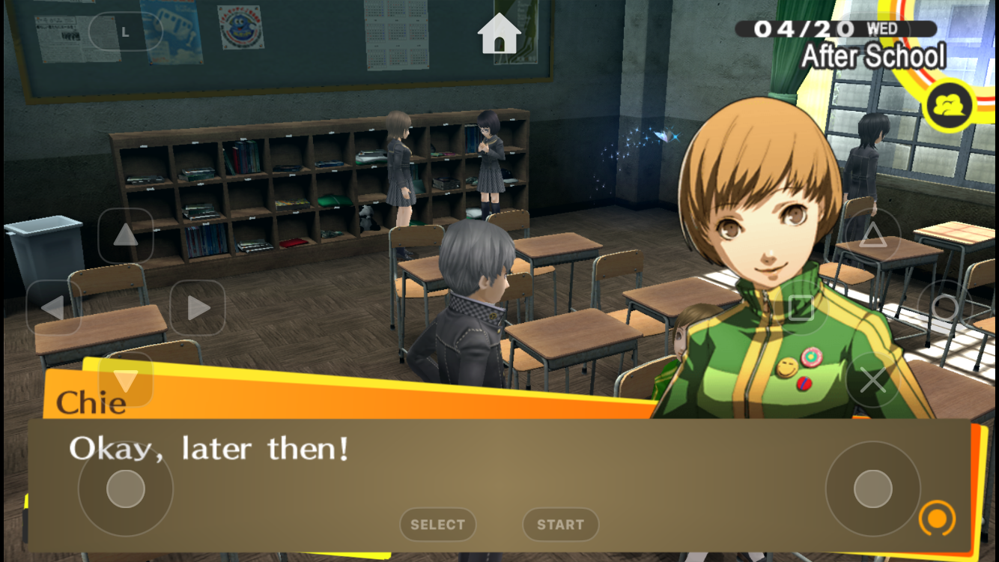
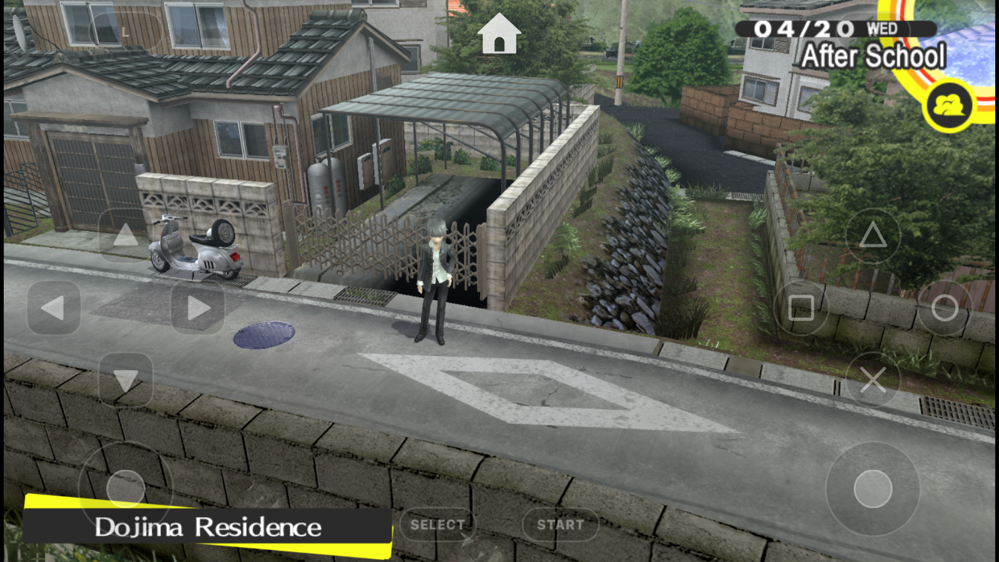
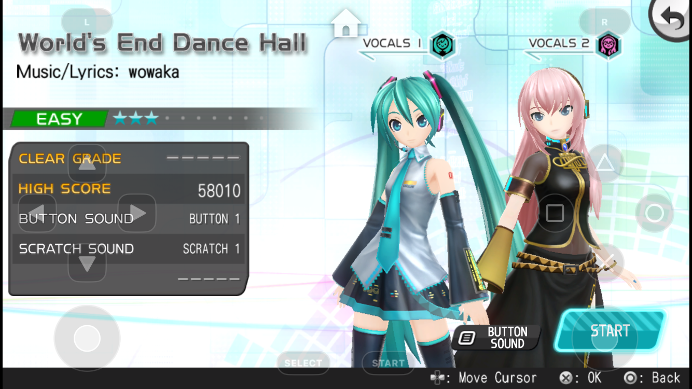
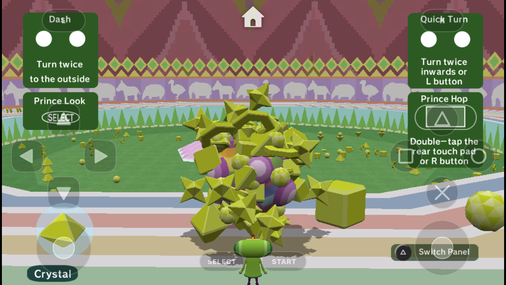
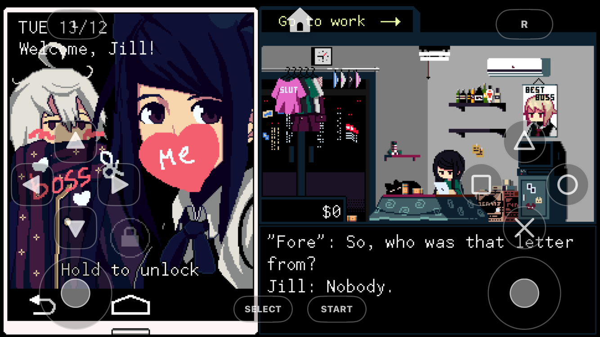

# Flowyr

Flowyr is an experimental PlayStation Vita emulator for iOS and iPadOS, based on [Vita3K](https://vita3k.org/) and [Veeb](https://github.com/veebteam/Veeb). Some games run well, some have glitches, and some don't run at all.

| | |
|:---:|:---:|
|  |  |
|  |  |
|  |  |

Captured on an iPhone SE (2nd generation).

## Requirements

- iOS 26 or newer
- 3 GB of RAM or more
- JIT enabled through StikDebug

## Installation

1. Download the unsigned IPA from the latest GitHub Actions run.
2. Sideload it with SideStore or your preferred method.
3. Open Flowyr through StikDebug with the `Universal.js` script to enable JIT. The lightning bolt in the top bar turns green when it's connected.
4. Import your own Vita firmware and games with the plus button.

To build it yourself you need a Mac with Xcode. See [building.md](building.md).

## Contributing

Bug reports with a log and the game's title ID are the most useful thing you can send. Pull requests are welcome. Workarounds that only make sense for one game should be scoped to that title ID.

## Legal

Flowyr does not include PlayStation Vita firmware, system files, encryption keys, games or any other Sony software. You are responsible for getting those from hardware and software you own, in line with the laws where you live.

PlayStation and PlayStation Vita are trademarks of Sony Interactive Entertainment. Flowyr is not affiliated with or endorsed by Sony.

## How this was made

Flowyr is developed by one person with the help of an AI coding assistant. The AI writes much of the code; the maintainer decides what gets built and tests every change on a real iPhone SE (2nd generation).

## Credits

- The [Vita3K](https://vita3k.org/) developers and contributors
- The [Veeb](https://github.com/veebteam/Veeb) team, for the iOS port Flowyr started from
- [Vita3K Plus](https://github.com/nckstwrt/Vita3K-Plus) and its contributors, for game-specific compatibility fixes
- The StikDebug developers, for the JIT workflow
- Everyone who tests games and reports bugs

## License

GPLv2, same as Vita3K. See `COPYING.txt`.
